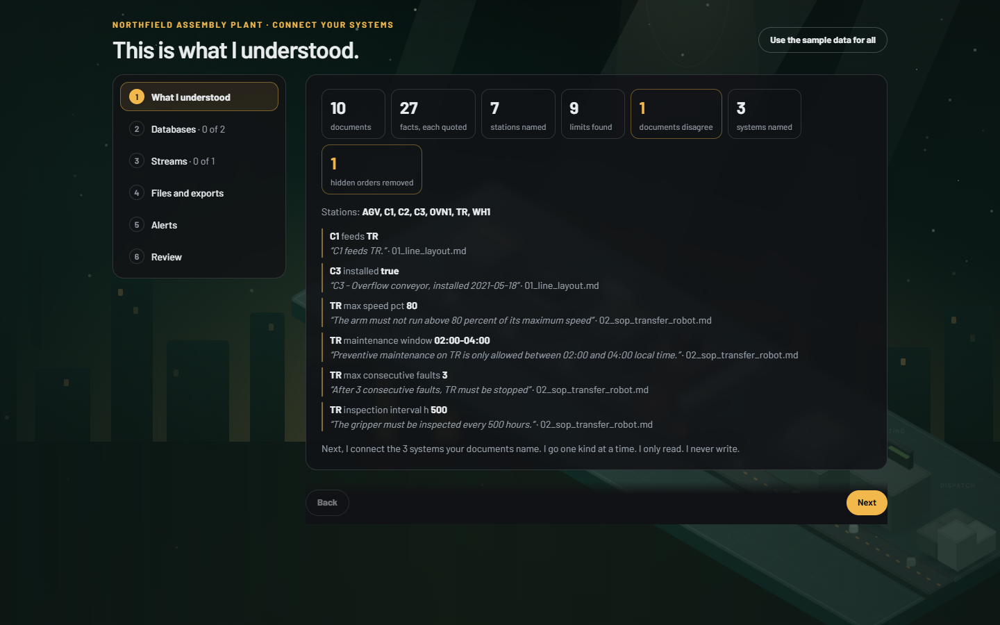
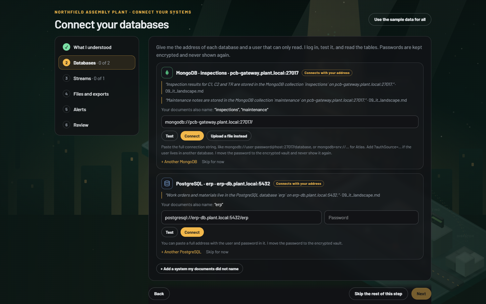
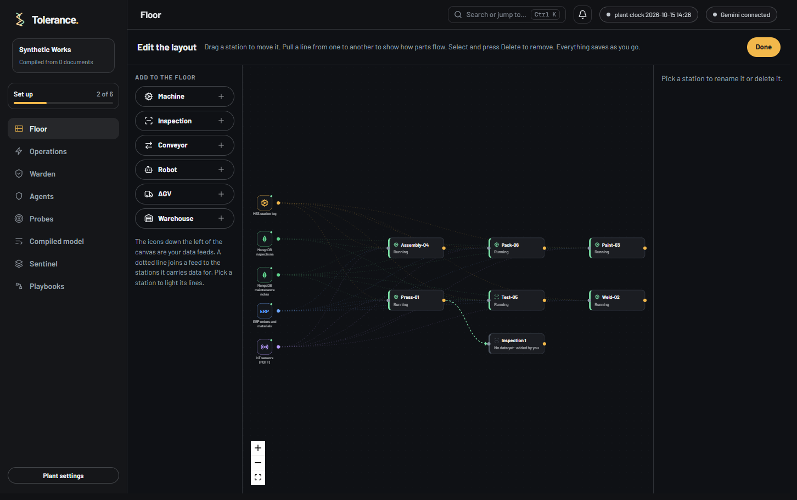
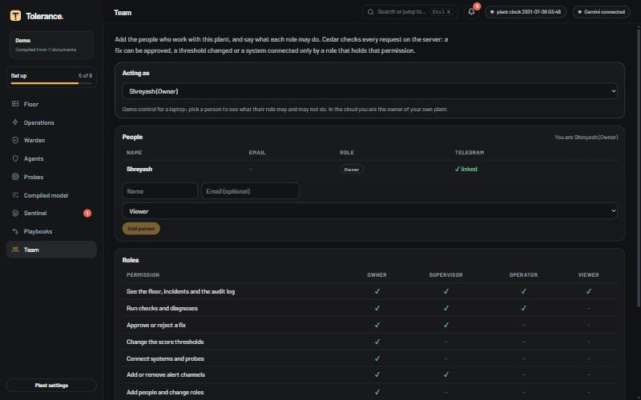
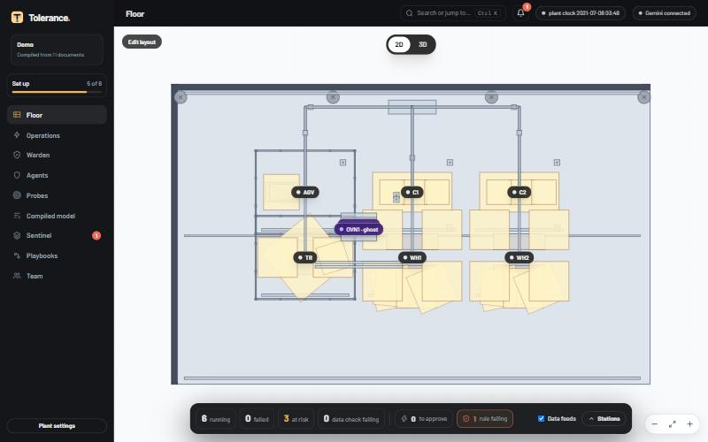
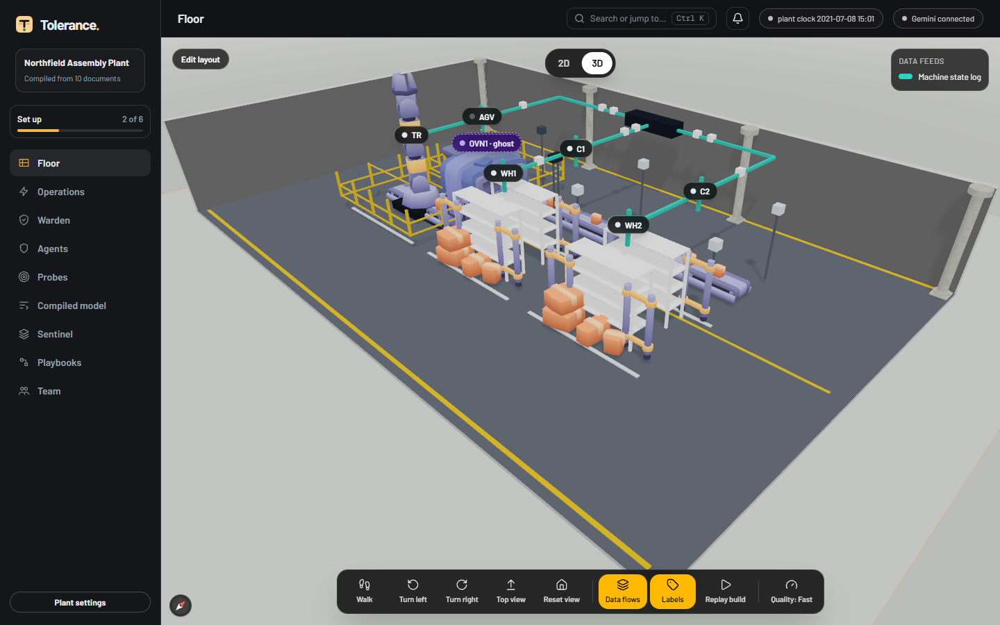

<p align="center"></p>

<h1 align="center">Tolerance</h1>

**An agentic platform for manufacturing, built around a Symbiotic Compiler.** Google Cloud AI Builder Cup 2026, Manufacturing theme.

A new plant gives Tolerance its name and its documents. Nine agents work from them. Four read them, ask the owner what is unclear, connect to the plant's data, and compile everything into one checked model of the plant. Other agents then diagnose failures, check their own findings, propose fixes, and score how safe each fix is. The owner decides how far the agents may act alone. A hard limit written in the plant's own documents is never crossed, whatever the score.

> Status: a working prototype. It runs on a laptop, and a copy runs on Google Cloud Run: https://tolerance-749288317336.asia-southeast1.run.app (sign in with Google, email, or as a guest). `deploy.sh`, the `Dockerfile` and `DEPLOY.md` describe the deployment.

## The idea in three diagrams

**The platform.** Nine agents on Foreman, with shared services, one policy gateway, MCP connectors and probes, and the machines.

<p align="center"></p>

**The journey.** From dropped documents to a decision at the gate.

<p align="center"></p>

**The safety gate (Warden).** Hard limits from your documents come first and are never overridden. Then Warden scores the action from 0 to 100 against the two lines you set.

<p align="center"></p>

## The ingestion step

After the owner gives the documents, the Guide shows what it understood (facts with their quotes, stations, limits, conflicts, hidden orders removed). Then a short **stepper** connects the systems the documents name, one kind at a time: **Databases**, **Streams**, **Files and exports**, **Alerts**, and a **Review**. Each system gets its own card with the sentence that names it. The owner can connect it, write it down for setup, or skip it, and **Use the sample data for all** is one button.

<p align="center"></p>
<p align="center"></p>

- **One address field for a database.** Paste a full connection string. The password goes to an encrypted vault and is never shown again.
- **Test before Connect.** Test logs in, runs one safe read and reports what it found.
- **Alerts is a choice.** The owner picks **Telegram**, **Slack**, **Microsoft Teams**, **Discord** or **Any webhook**, then fills in only that channel's setup (Telegram uses a short pairing code, see below).
- **A database on Google Cloud SQL** also asks the owner to sign in with Google, so Tolerance can watch the instance and start it again after an approval. The card says Connected only when both the login and the Google step worked.
- **The Guide helps with the questions.** It suggests what the plant makes from the documents (and keeps a field for anything else), asks once about all stations that have no data, and tries a step again by itself if it failed before saying anything.

## The floor editor, Sentinel, playbooks and channels

| | |
|---|---|
| <br>**Layout editor.** Move, add and delete stations. Data feeds join to the stations they serve. | <br>**Sentinel.** Rules, their checks, and what each one saw. |
| <br>**Playbooks.** Draw what happens when a station fails. | <br>**Channels.** Slack, Teams, Discord, Telegram or a webhook. |


- **Layout editor** (the "Edit layout" button on the floor, or `/floor?edit=1`): a node canvas in the style of the playbook canvas. Drag a station to move it, add a machine, inspection, conveyor, robot, AGV or warehouse from the left, rename or delete the selected one, and pull a line between two stations to say how parts flow. Every change saves at once to the plant model, and the 2D plan and the 3D view redraw from it. The data feeds show as icons at the left, joined to the stations they carry data for.
- **Sentinel** (`/sentinel`, the ninth agent): plain rules, no model. A rule is a list of checks (a field, an operator, a value) on a table of your data, a web address, a network port, a service, or what the documents say. A service check sends the first message of the protocol (MQTT, Redis, PostgreSQL, MySQL, MongoDB, RabbitMQ, OPC UA, Memcached, InfluxDB, ClickHouse, Elasticsearch, SQL Server port) and does not log in. The **Decide** check is optional and marked AI-assisted: Gemini puts up to 100 short texts (an alarm column, or the quotes from your documents) into labels you choose, its answer is limited to those labels, and a text that gives orders is treated as data. Plain checks then judge the counts. This is how Jev works, with Gemini: a model that can only answer from a fixed set of outputs. Next, a small Gemma tuned for this one job, classification for Sentinel, can take over. The engine choice is already in place. It can suggest checks for your connected data. A rule that fails, and one that recovers, tells your channels. Web, port, service and certificate checks reach public addresses only.
  - **A schedule** runs the rules by themselves every few minutes (the Decide check runs only on request, because it uses the model).
  - **Maintenance windows** keep planned work quiet: the rule still runs, but sends no message and its history shows grey. "Suggest from my documents" reads the maintenance times the SOPs state.
  - **An impact map** says which stations lose their data when a rule fails. A failing rule puts an amber warning on those stations in the 3D floor.
  - **Heartbeat checks** give a machine or script a secret address to call every few minutes. If the calls stop, the rule fails.
  - **Certificate checks** warn before a certificate on your MES or ERP address runs out.
- **Playbooks** (`/playbooks`): the owner draws what should happen when a station fails: a trigger, checks, a decision and actions. Checks read through the same policy gateway as the agents. Any action that changes the plant is scored by Warden first.
- **Channels** (on the Warden page): Slack, Teams, Discord, Telegram or any webhook. "A person must approve", blocked actions, failing Sentinel rules and playbook messages reach people where they work. Addresses stay on the server.

## The front door: landing page, sign in and register

`/` is the public landing page (static files in `web/public`, an animated factory scene and the Symbiotic Compiler story). Sign in, Register and "Try it as a guest" are in the top bar and under the headline, and again at the end. They lead to `/signin/`, which has Google, email and password (with a password reset), and a guest button. A signed-in visitor goes straight to the floor, or to the page they asked for (`/signin/?next=`). Further down, an "Inside the product" section shows real screens of the floor with data feeds, the layout editor, the nine agents, Warden, Sentinel and playbooks. "Watch the journey" opens `/enter/`, an interactive follow-a-fault story that needs no account.

## Connecting your own systems

After the documents are read, the Guide lists every system they name. Each database, server and broker gets its own card with the sentence that names it, the address the documents give, a password or token box, and two buttons: **Test** (log in, run one safe read, report time and what is there) and **Connect** (test again, keep the password encrypted, load the data, then keep it current). A plant can have many of each kind, so every card has "+ Another", and a menu adds systems the documents did not name.

| System | What happens |
|---|---|
| PostgreSQL, MySQL / MariaDB, SQL Server, Oracle | Log in with the driver, run `SELECT 1` or your own read, list tables. Snapshot, then new rows by key |
| MongoDB | Log in, `ping`, list collections. Each collection is a table, new documents by `_id`. A `mongoexport` file can be uploaded instead |
| MQTT | Connect with the login, subscribe to the topic, and read messages into a table |
| Kafka | Read a topic from the saved offset |
| OPC UA | Connect and browse the objects (read only) |
| REST / ERP / MES / SAP services | GET the address with the token. JSON lists become tables |
| MCP servers | Connect over HTTP (streamable HTTP, then SSE), list the tools. They join the same hub as the built-in servers. Only tools the server marks read-only can run, through the policy gateway. Any other tool is denied. The Diagnosis agent may use the read-only ones |

The tests follow the Kanshi executors (same login, same safe-read rule, same answer shape). Only reads are allowed: SELECT, SHOW, DESCRIBE, EXPLAIN, WITH, VALUES. Passwords and tokens are encrypted with a key from `TOLERANCE_VAULT_KEY` (a key file is made on a laptop with none) and are never sent back to the browser. In the cloud, addresses inside a private network are refused. A plant system on a private network needs a probe or tunnel to reach it. Tests: `tests/probes_test.py`, `tests/live_sources_test.py`, `tests/mcp_remote_test.py`, `tests/systems_test.py` (they use a real PostgreSQL and a real MQTT broker, a MongoDB stand-in, and a local MCP server; Kafka and Oracle and SQL Server are not tested against a live server).

## Watching a server and a database, and approving fixes

Tolerance does not only look at machines. It can watch the computers and databases the plant runs on, and fix them after a person approves.

- **A probe on a server.** A small program (`probe/`) runs on the plant's server. It only makes outbound HTTPS calls, so no port is opened. It reports which services are up (the MQTT broker and the database, for example) and readings such as the oven temperature. The Probes page shows the two values to put in the probe's settings.
- **Incidents.** When a service stops, an incident opens: *waiting*, then *applying* once a person approves, then *resolved*. Warden scores the proposed fix first. A hard limit from the documents is never crossed: the oven setpoint can be lowered to a safe value, and a value above the limit is refused.
- **A short list of commands.** The probe runs only commands on its own list (restart a named service, set the oven setpoint), and only after an approval.
- **Google Cloud SQL.** The owner presses **Connect Google Cloud** and signs in on Google's screen. Tolerance keeps the refresh token in the encrypted vault and checks the instance state every few seconds. When the instance is stopped, it opens an incident, and after an approval it sends one command: start. It never stops or deletes anything. The scope asked for is `sqlservice.admin`, and it acts with the rights of the person who signed in.
- **Approve on Telegram.** The owner pairs a bot with `/pair CODE`. Each incident arrives as a message with **Approve** and **Reject** buttons, and a *resolved* message follows. A tap is checked against the team: only a person whose role may approve fixes can approve. Tolerance reads the taps by polling Telegram, so it needs no public webhook.

## People and roles

The **Team** page lists who may do what. Cedar, the same policy engine that decides what the agents may do, decides for people too, and the server checks every protected request.

<p align="center"></p>

- Four built-in roles (**Owner**, **Supervisor**, **Operator**, **Viewer**), and custom roles made from seven permissions: see, run checks, approve or reject a fix, change thresholds, connect systems, manage alert channels, manage the team.
- Someone with a role that may not approve gets a refusal, and the refusal is written to the audit log.
- On a laptop, **Acting as** lets the owner pick a person to show what each role can and cannot do. In the cloud, the signed-in person owns their own plant.

## Data feeds from many systems

Upload several files at once and each one becomes a feed with its own icon: a machine log (MES), a MongoDB export (`.json` or `.jsonl`, as `mongoexport` writes it; `_id`, `$date` and number wrappers are unwrapped and nested fields become columns), an ERP database or CSV, an IoT log. Tolerance names the system from the file or from a tag, then finds which stations each feed carries data for by looking for station names in its columns. The icons sit down the left of the 2D plan (point at one for its rows, freshness and stations), and in the Cards view lines join a feed to its stations.

No files yet? In the Guide, press "Try a made-up plant with MES, MongoDB, ERP and IoT data". It writes the files with `workspace/synthetic.py` (`python -m workspace.synthetic OUT_DIR` writes them to a folder), loads them into your own private database and draws the feeds. `python tests/feeds_test.py` checks the whole path. Honest limit: MongoDB is read from export files. A live connection to a MongoDB server is listed as a bridge, not built.

## Easier to use

Some of the ideas for the interface come from the Kanshi project, which has a very clear monitoring UI.

- **A rule wizard.** Adding a Sentinel rule takes four steps: Type, Details, Checks, Review. The type is chosen from tiles, each with an icon and one line. In the Checks step you press **Test it now**, see the real fields, and click one to make a check. A number starts with a wide margin around what it showed. Presets fill in a sensible set in one click.
- **Search or jump to** (Ctrl+K, or the button in the top bar): pages, stations, rules and playbooks, plus a few actions.
- **A bell** for what needs a person now: actions that wait for approval, and failing rules.
- **A set-up list** under the plant name, with progress. Each step ticks itself when it is done.
- **Calm lists.** Failing rules come first and stay open. Passing rules are one line, open with a click. An empty page says what to do next.
- **It all feels connected.** The left menu shows counts where something needs a look (a failed station on Floor and Operations, a failing rule on Sentinel), and they match the bottom panel on the floor and the bell. One shared feed drives all three.
- **Show the main thing, fold the rest.** The floor plan keeps its look; the controls float over it. Operations opens on a list of the stations that need attention, each with one button. Warden shows your two lines and what was applied; the expert scoring tool and the channel form are folded away until you want them.

## The floor: the plan, with controls, and a 3D factory

The floor has a switch at the top: **2D** and **3D**.

- **2D is the floor plan,** drawn from the confirmed plan, at full size, with the data feeds. A **floating panel at the bottom** tracks the plant live: four tiles (running, failed, at risk, data check failing) that filter the stations, and two chips that go the same way as items in the left menu, **to approve** (Operations) and **rules failing** (Sentinel). Point at one of those chips and the matching menu item glows. **Stations** opens a list with the ones needing attention first. Click a station for its failure risk, the data it uses, the Sentinel rules that touch it, and the next step: **Find the cause and fix it**, or **Show it in 3D**. When a station fails, a red line at the top of the panel offers the fix at once.
- **3D is for looking around.** The factory assembles itself from the confirmed plan, with machines built from the CC0 Kenney Factory Kit models (conveyors with crates, a turning robot arm, scanners, hoppers) and Pascal shelving racks. Data flows show as cables, and a failing data check puts an amber warning on the stations it feeds.

<p align="center"></p>
<p align="center"></p>

**How 3D should be used, and why it is built this way.** The Pascal viewer is a full rendering engine with a heavy post-processing pipeline: ambient occlusion, global illumination, anti-aliasing and outlines. That is the main cost, and on a weak or shared graphics card it makes the page stall. So:

- **Fast is the default.** It skips that pipeline, uses flat shading and caps the frame rate at 40. **Full** quality turns it back on, from the bar at the bottom. Fast loaded the sample plant in under 8 seconds in a scripted Chrome run.
- The viewer starts only when you ask for 3D. The status map does not need it.
- Rendering is paused while you are on 2D or the tab is hidden, but only once the scene is ready (it needs frames to become ready).
- A station is touched only when its colour changes, and a graphics reset restarts the viewer by itself.
- A plant with more than 16 stations draws one box per machine.
- Hover tips from the viewer (raw names such as "Floor slab") are off.

Switching from 3D to 2D keeps the viewer mounted, so coming back is fast.

## Animated figures (Anatomy)

These are interactive in the app and in the deck (they move). Here they are as stills. Each one shows a real mechanism of the product, drawn with the [Anatomy](https://github.com/wheresryan22/anatomy) kit.

| | |
|---|---|
| <br>**The tolerance gauge.** A part is measured against its tolerance band: in or out. | <br>**One platform.** The agents stand on one shared base: one gateway, one policy, one record. |
| <br>**The interlock.** Every tool call reaches one gate. Reads pass. A write stops and waits for a person. | <br>**The Warden gates.** The first gate is your floor, the second is your limit. A score between them waits for a person. |
| <br>**The selector.** A contextual bandit learns which evidence to read first, and a confirmed diagnosis rewards the choice. | |

The first-time flow also draws the owner's own plant in this style, from what the Guide learned (see "Your plant, drawn" below).

## The app, screen by screen

The first-time flow, as a new visitor sees it. These screenshots come from the end-to-end test (`node tests/e2e.mjs`), which saves one for every step.

| | |
|---|---|
| <br>**1. The plant name.** The only question on the first screen. No menu yet. | <br>**2. Drop your documents.** Manuals, work instructions, safety rules, emails. The list fills a box of fixed height, so the button stays put. |
| <br>**3. Connect your systems,** one kind at a time, with Test, Connect or Skip. | <br>**4. The Guide talks with the owner.** It asks what the plant makes, then settles conflicts between documents. |
| <br>**5. Your plant, drawn.** Gemini turns the confirmed understanding into a layout. | <br>**6. The tour.** The menu grows one section at a time while the Guide says what each is for. |
| <br>**7. The floor in 2D,** with live status tiles. | <br>**8. The floor in 3D.** Data flows show as cables. |
| <br>**9. Operations.** What happened, what we suggest, and whether it needs a person. | <br>**10. Warden.** You set two lines. The chart shows what they would have done on 465 recorded incidents. |
| <br>**11. A hard limit.** An action above a limit from your documents is blocked, whatever the score. | <br>**12. Agents.** Each agent has a card: what it may touch and what it may not. |
| <br>**13. The compiled model.** Every fact keeps the exact words it came from. | <br>**14. The Team.** People, roles and permissions, checked by Cedar. |

## The pitch deck

A three-minute deck that runs in the browser at `/deck`, with the live app embedded.

| | |
|---|---|
| <br>The platform | <br>Operations: the Verifier catches a wrong number |
| <br>Warden | <br>Roadmap |
| <br>Appendix: rules, playbooks and people | |

## What a person sees

1. **Plant name.** The only question on the first screen. No menu, no panels.
2. **A spark takes over the name.** A glowing spark sweeps across the typed plant name and the letters fill with colour. It lasts about four seconds and can be skipped.
3. **Drop your documents.** A real drag-and-drop area. A sample pack of nine documents is available for people who have none.
3b. **Connect your systems.** A stepper goes through the databases, streams, files and alerts the documents name (see "The ingestion step").
4. **The Guide talks with the owner.** It reads the documents, asks which data sources to connect, asks what the plant makes, and settles conflicts between documents, missing stations and hard limits, one question at a time.
5. **The plant, drawn.** Gemini turns the confirmed understanding into a layout, and the Anatomy kit draws it.
6. **A tour.** The menu grows one section at a time: Floor (3D), Operations, Warden, Agents, Probes, Symbiotic Compiler. The Guide says what each is for, tied to what the plant makes.

Settings has "Show me around" and "Start over".

## The agents (Foreman)

<p align="center"></p>


Foreman is the layer that runs the agents: a contract card per agent, a visible record of every step, one policy gateway, and a record and replay for model calls. Every agent can use Gemini. In Sentinel it only puts short texts into labels you choose, and plain rules decide every result. Plain code is labelled as such (model-driven, rule-driven, or mixed).

| Agent | Job | Where Gemini is used |
|---|---|---|
| Guide | Talks with the owner and runs onboarding | Writes each message, reads free-text answers, writes the layout and the tour |
| Document Reader | Documents into facts, each with its exact quote | Claim extraction. Code checks every quote against the page. Instructions hidden in documents are removed first |
| Connector Scout | Says what each connected table holds | Names the role of each table from its columns |
| Plant Modeler | Writes the overview and the 2D plan | Writes the overview from the facts only |
| Diagnosis | Finds why a station failed | Chooses read-only tools and writes the diagnosis |
| Verifier | Recomputes every number the diagnosis cites | Reviews the argument. A failed number check cannot be argued away |
| Remediation Planner | Proposes the fix with exact settings | Chooses the action and settings |
| Warden | Scores each action from 0 to 100 | Writes the plain reason. The score itself is rule-driven so it can be audited |
| Sentinel | Checks your systems and the agents' claims with plain rules | Only in the optional Decide check: Gemini puts short texts into labels you choose, and its answer is limited to those labels. Code decides every result |

**Warden.** Six factors give the score. The owner sets two lines: below the floor an action is refused, between the lines a person approves it, at or above the limit it may run by itself. Cedar enforces this at the Action Broker. The page shows a backtest on 465 recorded RCAEval incidents, so the owner sees what the lines would have done before trusting them.

## Google Cloud usage

| Google service | Used for | Code |
|---|---|---|
| **Gemini** (Vertex AI when deployed, Google AI Studio on a laptop) | Every agent above, plus the incident investigator with tool use, semantic naming and the chat | `fabric/agents.py` (client, model pool, retry), `foreman/llm.py` (JSON answers, tool loop, record and replay, call ledger), `documents/engine.py`, `foreman/guide.py`, `foreman/agents.py`, `rca/gemini.py`, `compiler/semantics.py`, `interpret/engine.py`, `discover/fingerprint.py`, `workspace/graph.py` |
| **Vertex AI** | Gemini without an API key in the container, using the Cloud Run service account | `fabric/agents.py` (`GOOGLE_GENAI_USE_VERTEXAI`), `deploy.sh` |
| **Cloud SQL Admin API** | Reads the state of a Cloud SQL instance and starts it again after an approval, using the signed-in person's Google account (OAuth, scope `sqlservice.admin`) or the Cloud Run service account | `server/cloudsql.py` |
| **Firebase Authentication** | Sign in with Google, email and password, or as a guest | `web/lib/auth.ts`, `server/auth.py` |
| **Cloud Run** | Hosting the backend and the screens | `Dockerfile`, `deploy.sh`, `DEPLOY.md` |
| **Cloud Build** | Building the container from source (`gcloud run deploy --source .`) | `deploy.sh` |

Optional and off in the deployed app: if Gemini does not answer, a small Gemma model on Fireworks AI can answer instead (`foreman/llm.py`, set `FIREWORKS_API_KEY`). It runs outside Google Cloud, so `deploy.sh` sets `FALLBACK_GEMMA=0`. Every such answer is labelled "fallback" in the agent trace.

Not Google, and used on purpose: Cedar (policy), the Model Context Protocol (the tool layer), DuckDB, dlt, Pascal Editor (3D), the Anatomy kit (figures).

## What is real, replayed, simulated

| Piece | State |
|---|---|
| Machine telemetry | Real. The Industry 4.0 Lab state log of the University of Southern Denmark (Zenodo 5078737, CC BY 4.0), replayed as if live |
| Incident archive and backtest | Real. The 465 fault-injection cases of RCAEval. There is no incident history from a real plant, so the Warden backtest covers software incidents only |
| Inspection data | Real. UCI SECOM |
| Documents in the sample pack | Synthetic, with real station names |
| Plant actions | Simulated. The plant is replayed data, so every applied action runs in a simulator |
| Probes | Real programs. They test the plant interfaces (OPC UA and the ERP) and compare views from several places. A fault can be injected, and it is always marked as injected |
| Gemini answers in demos | Live when Gemini answers. Recorded answers replay when it does not, and are labelled "recorded" |

## Run it

Needs Python 3.11 and Node 22.

```bash
python -m venv .venv && .venv/Scripts/activate        # bin/activate on Linux or macOS
pip install -r requirements.txt
cp .env.example .env                                   # add GEMINI_API_KEY
cd web && npm install && npm run build && cd ..
```

Windows: `.\run_local.ps1` starts the backend (port 48410) and the web app (port 3000), then open http://localhost:3000. `.\run_local.ps1 -Stop` stops them.
Elsewhere: `python -m uvicorn server.app:app --port 48410` and, in `web/`, `npx next start -p 3000`.

The first visit starts the first-time flow. "Start over" in Plant settings brings it back.

## Tests

```bash
python -m tests.foreman_test        # checks on Warden, the Cedar gate, the Verifier, the nine contracts and the fallback. No Gemini needed
python tests/sentinel_test.py       # the Sentinel rule engine and its address guard
python tests/sentinel_protocols_test.py   # the service checks, against small fake servers
python tests/sentinel_decide_test.py      # the Decide check, with a stand-in for the model
python tests/sentinel_service_test.py     # heartbeats, maintenance windows, the schedule and failure messages
python tests/hostops_test.py        # server incidents, approvals, the probe's command list
python tests/cloudsql_test.py       # the Cloud SQL watch: stop, approve, start, resolve
python tests/cloud_oauth_test.py    # the Google connection: sealed state, vault, refresh, disconnect
python tests/rbac_test.py           # people, roles and the Cedar checks
python tests/telegram_buttons_test.py   # approval buttons; telegram_pair_test.py for the pairing
python tests/guide_flow_test.py     # the Guide's retry and suggestions; guide_own_lake_test.py for database-only plants
node tests/e2e.mjs                  # drives the whole app in real Chrome: first visit, Guide, tour, Operations, Warden, Probes, deck
```

`node tests/e2e.mjs` writes a screenshot of every step to `docs/e2e/` and a report to `docs/e2e/REPORT.md`.

## Where things are

| Folder | What |
|---|---|
| `foreman/` | The agents, the Guide, Warden, the gateway, playbooks, channels and the model layer |
| `sentinel/` | Sentinel: the rule engine, the checks, the service protocol checks and the address guard |
| `server/` | FastAPI: `/api/jig/*` (platform), `/api/probes`, `/api/ws/*` (workspace) |
| `probe/` | The probe program (paths and readings from the machines) |
| `server/hostops.py`, `server/cloudsql.py`, `server/rbac.py` | Server incidents and approvals, the Cloud SQL watch and Google connection, people and roles |
| `documents/`, `mcpx/`, `fabric/`, `rca/` | Document engine, MCP servers and hub, policy gateway, incident investigator |
| `web/` | Next.js app: first-time flow, Floor and floor editor, Operations, Warden, Agents, Probes, Sentinel, Playbooks, deck at `/deck` |
| `deck/` | Anatomy figures for the pitch deck |
| `docs/` | End goal, build log, UX review, diagrams, figures and screenshots |

More: `docs/END_GOAL.md` (the plan and why), `docs/BUILD_LOG.md` (what is built and measured), `docs/UX_REVIEW.md`.

## Licences

Third-party code and data are listed in `THIRD_PARTY_NOTICES.md`.
